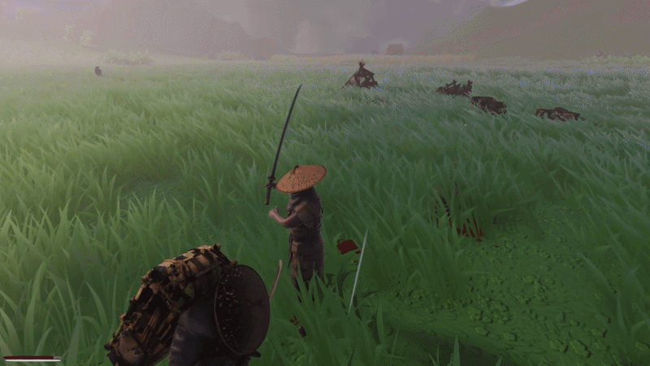

# Feudal Japan Survival Action RPG

> A third-person survival action RPG in feudal Japan: explore on foot or on horseback, fight bandits and bosses, manage hunger, thirst and rest, and grow stronger through equipment. Solo or online co-op (2–4 players).

   

<!-- Replace with a GIF or screenshot of gameplay -->

**▶ Trailer:** [YouTube link](#) · **Systems walkthrough:** [YouTube link](#) · **Playable build:** [itch.io link](#)

---

## About

A solo project built in Unity 6 (URP). The goal is a polished vertical slice that shows four design pillars:

1. **Rewarding exploration** – every place offers equipment, resources, danger or scenery.
2. **Combat with weight** – clear attacks, blocks and dodges; mistakes have consequences.
3. **Survival that pressures without frustrating** – hunger, thirst and sleep create rhythm, not punishment.
4. **A living world** – day/night, rain, wind, fog, leaves, animals and sound react to each other.

References: *The Witcher*, *Outward*, *Ghost of Tsushima*, *Red Dead Redemption*.

## Features

**Combat**
- Two-hit combo, strong attack, random kick, block, directional dodge with i-frames
- Aim assist and lunge so swings connect; hit-stop, camera shake, sparks and blood
- Bow with crosshair and physical arrows
- Cinematic finishers (slow motion + close camera)
- Boss fights: camera lock-on, strafing around the boss, boss health bar, boss resets when the player dies
- Enemy groups that take turns attacking; melee and archer AI on the NavMesh

**Survival and world**
- Hunger and thirst with soft penalties, quick slots for food and drink
- Tents: sleep with a sky time-lapse, set respawn point; respawn choice on death
- 24-minute day/night cycle, automatic weather with rain presets, wind, volumetric fog
- Falling leaves from real terrain trees, leaf piles kicked by characters, animals (birds that take off and glide, foxes that flee and can be hunted)
- Surprise patrols that cross the player's path (also while riding)
- The sea as a natural border (fade out → back on land)

**Exploration and progression**
- Horse: call, mount, walk / trot / gallop with horse stamina, procedural rider pose; horses bought at a stable
- Inventory with equipment shown on the character, backpack with extra storage and perks; the backpack can be dropped and picked up with its contents
- Upgrade stones (refine, double with risk, demon possession with perks)
- Crafting and cooking stations, placeable tents / bonfires / tables
- Gathering, chests with random loot, merchants, delivery quests between NPCs
- Map with fog of war and minimap

**Menus, saves and online**
- Main menu, pause menu, settings (controls, gameplay, video, audio)
- Save list like *The Witcher*: quick saves, manual saves, rotating autosaves, load and delete
- Online co-op with join codes (Unity Relay): each player keeps their own save; time, weather and enemies are shared

## Technical highlights

| Topic | What I did |
|---|---|
| **Architecture** | Self-creating systems (`RuntimeInitializeOnLoadMethod` + persistent singletons), shared helpers (`WorldUtil`, `PlayerRef`, `UIKit`, `UIStyle`, `MenuWindow`) after a refactor that merged duplicated code across ~60 files without changing behavior |
| **Save system** | One JSON file per save, atomic writes (`.tmp` → `File.Replace` with `.bak`), autosave rotation, migration from the old single-file format |
| **Networking** | Netcode for GameObjects + Relay; custom named messages instead of NetworkObjects (players at 15 Hz, enemies at 10 Hz, host-authoritative enemies, validated client hits) |
| **Animation** | Animator blend trees, foot IK, procedural rider pose, and the **Playables API** for animals and NPCs without Animator Controllers |
| **Camera** | One controller blending modes by weights: dynamic combat, boss lock-on, finisher, riding, scenic view with cinematic bars |
| **UI in code** | Every window (inventory, loot, shop, crafting, stable, map, settings, saves) is built from code with one shared style |
| **Performance** | Editor tool to profile and lighten terrain and shadows (grass 9.3M → 1.5M triangles), throttled searches, registries, timed cleanup of world leftovers |
| **Editor tooling** | Item database builder, performance tools, shader inclusion for builds |

## Where to look in the code

| System | Main scripts |
|---|---|
| Player movement and combat | `Character/Player/Controls/PlayerMovement.cs`, `PlayerCombat.cs`, `PlayerDodge.cs` |
| Camera | `Character/Player/Camera/CameraController.cs` |
| Enemy AI and bosses | `Character/Enemy/EnemyAI_01.cs`, `World Managers/EnemySpawner.cs`, `RoamingPatrolSpawner.cs` |
| Horse | `Character/Player/Mechanics/HorseMount.cs` |
| Animals | `Animals/AnimalSpawner.cs`, `BirdAI.cs`, `FoxAI.cs`, `ClipBlender.cs` |
| Inventory and items | `Character/Player/Player UI/Player/*`, `Character/Player/Data/*` |
| Save system | `World Managers/WorldSaveGameManager.cs`, `Save/SaveData.cs` |
| Settings and menus | `World Managers/GameSettings.cs`, `Menu Scene/*`, `Character/Player/Player UI/PauseMenu.cs` |
| Multiplayer | `Multiplayer/*` |
| Weather and world | `World Managers/DayNightCycle.cs`, `RainSystem.cs`, `FallingLeaves.cs`, `WorldCleanup.cs` |

## Design documents

- [Game Design Document (v3)](docs/GDD%20-%20Feudal%20Japan%20Survival%20Action%20RPG%20v3.docx)
- [Technical Design Document (v3)](docs/TDD%20-%20Feudal%20Japan%20Survival%20Action%20RPG%20v3.docx)
- Mechanic breakdowns:
  - [Combat and boss fights](docs/mechanics/01-combat-and-bosses.md)
  - [Survival: needs, sleep and the sea border](docs/mechanics/02-survival.md)
  - [Inventory, backpack and loot cleanup](docs/mechanics/03-inventory-and-backpack.md)
  - [Enemies, patrols and animals](docs/mechanics/04-enemies-patrols-animals.md)

## Controls

| Key | Action |
|---|---|
| WASD / Mouse | Move / camera |
| Shift | Run (horse: tap = trot, hold = gallop) |
| Space / C / Left Alt | Jump / slide / dodge |
| 1 / 2 | Sword / bow |
| LMB / RMB / F / Q | Attack / second attack or aim / strong attack / block |
| E | Interact, loot, gather, mount |
| I / M | Inventory / map |
| H | Call horse |
| B / Z | Sit / sleep at a tent |
| R / T | Drop backpack / pick up placed object |
| 3 4 5 | Quick slots |
| Caps Lock | Scenic view |
| F5 / P / F8 | Quick save / pause / multiplayer |

## Development process

Designed, directed and tested by me. I used an **AI-assisted workflow** (Claude) to prototype and implement systems quickly: I define the mechanic and its feel, review and integrate the code, test it in Unity and iterate on the result. The mechanic documents show some of those iterations (what didn't work and what changed).

## Running the project

- Unity **6000.6.2f1** with URP.
- This repository contains the **source code and documentation**. Third-party art, animation and audio assets are not included (licensed), so the project will not open as a complete game from this repository alone. A playable build is on itch.io.

## Roadmap

- [ ] Final map layout and zones, quests
- [ ] Crafting recipes, prices and delivery routes
- [ ] Balancing pass (combat, needs, horse, patrols)
- [ ] Final audio
- [ ] Co-op playtests with more players

## Author

**Artur** – 3rd-year student of Computer Science and Multimedia Engineering (LEIM) at ISEL, Lisbon.
[LinkedIn](#) · [Portfolio](#) · [Email](#)
